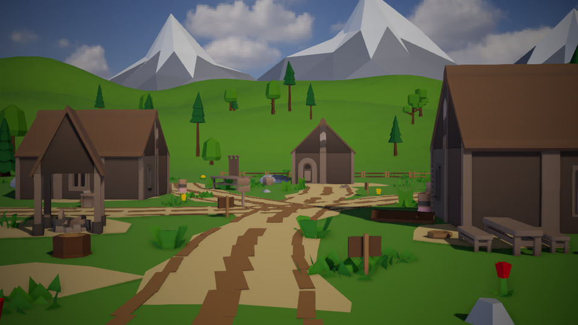

# Calyx Demos

A Calyx project of standalone demo scenes, each one showing off what the
engine renders. It sits next to `sandbox/`, the tank game, and leaves it
alone.

Open it in the editor with

```
calyx_ctl launch --release --project ./demos
```

or `cargo run -p calyx_editor --release -- ./demos`. Play starts the
project's startup scene, the first demo below. To switch demos, open another
scene from the content browser, or with `calyx_ctl scene load <path>`, and
press play.

## Demos

| Demo | Scene | |
| --- | --- | --- |
|  | [`assets/rpg_poly/rpg_poly.cxscene`](assets/rpg_poly/rpg_poly.cxscene) | **RPG Poly village.** A remake of the demo village from Unity's [RPG Poly Pack - Lite](https://assetstore.unity.com/packages/3d/environments/landscapes/rpg-poly-pack-lite-148410), rebuilt from CC0 assets: log houses, plank walkways, pines and props in a valley under snowy peaks, with sun shadows, a sky and a post-processing volume. In play the camera flies a loop around the village. |

## Assets

Third-party assets and their licences are listed in
[`THIRD_PARTY_ASSETS.md`](THIRD_PARTY_ASSETS.md).

`tools/rpg_poly/build.py` regenerates the RPG Poly village's meshes,
textures, materials and scene from the downloaded Kenney kits; see its
docstring. The demo's components, such as the camera path, are in `src/`.
