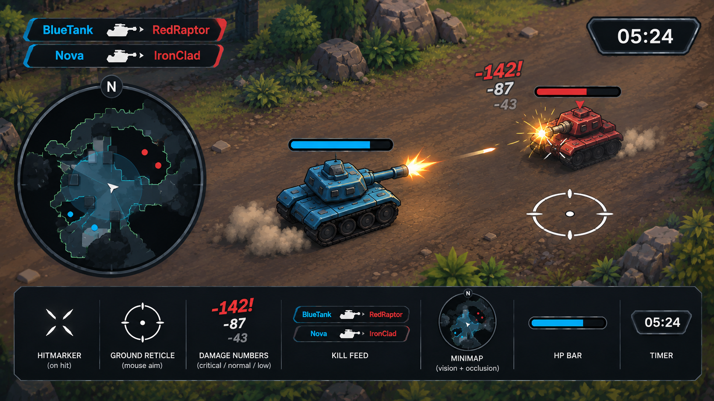
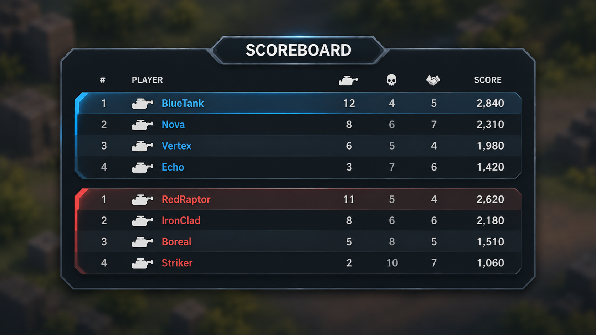

# HUD Visual Direction

The supplied gameplay and scoreboard concepts are the visual reference for the
tank game's HUD. Match their shapes, colour hierarchy, typography, proportions
and placement. This direction replaces the earlier cream-panel HUD treatment;
the world keeps its [tank-game art direction](../art/tank-game-direction.md).

## References

The original images are preserved without alteration:

- [Gameplay HUD concept](concepts/gameplay-hud.png): combat overlays, kill feed,
  circular minimap and timer. Its bottom strip is a reference legend explaining
  the elements, not a toolbar to display during play.
- [Scoreboard concept](concepts/scoreboard.png): panel shape, title, columns,
  team grouping, row hierarchy and backdrop treatment.

## Visual rules

- Near-black, subtly blue-grey surfaces with angular, clipped corners and
  layered steel-grey borders. Reserve bright accents for information and state.
- Cyan identifies the friendly side; red identifies the opposing side. Text
  and symbols are crisp off-white, with quieter grey for secondary information.
- Use the concepts' tank, skull and assist symbols and strong sans-serif type
  hierarchy. Keep symbols legible at gameplay size and align numeric columns.
- Anchor the kill feed at the upper left, with the circular minimap below it.
  Place the double-bevelled hexagonal timer at the upper right. Size elements
  against the rendered playfield, not the concept image pixels. The radar
  diameter is about 15% of the view width, including compact layouts.
- Show rounded black HP tracks above combatants, filled with their side colour.
  Width follows 90% of each tank's projected visible mesh bounds (48px minimum);
  anchor the pill 32px above the projected top. Keep enemy arrows between it
  and the tank. The existing scene crosshair stays visible until #526 supplies
  its ground model; the HUD must not draw a substitute ground reticle. Four
  filled, tapered blades confirm damage at the aim point for 0.25 seconds.
- Float damage values near their target: large red emphasis for high
  damage, light normal damage and smaller muted low damage. Use real bold
  italic type with a coverage-mask outline, a short pop, and a 1.4-second life.
  New hits stack above older hits above the HP bar, slightly to one side.
- The scoreboard is a wide centred bevelled panel with an attached title plate,
  cyan and red team sections, aligned rank/player/kills/deaths/assists/score
  columns, alternating dark rows and a clearly highlighted leading row.
  Blur and darken the scene behind it, and hide the gameplay overlays while the
  table is open, so the table remains the visual focus.
- Omit the bottom health and ammo panels entirely. Health remains visible in
  world HP bars; weapon, reload and respawn gameplay remains unchanged.
- Use the bundled OFL Barlow Bold and Bold Italic faces, with
  backend glyph metrics for centring and ellipsis. Outlined text is a single
  cached coverage image, never several offset draws. Font source and license
  are recorded alongside the bundled files in the engine UI fonts directory.

## Live behavior

Every depicted element is functional. Values, names, team membership, visibility,
combat feedback and time come from game state. The example players, counts and
time printed in the concepts illustrate the layout and are not fixed content.

Hit markers respond to the local player's confirmed damage. Damage numbers
follow actual hits, age and disappear. The scoreboard counts real kills,
deaths, assists and score. The timer advances with simulation time. The minimap
shows terrain and cover with a circular visibility area, occlusion and friendly
or detected hostile contacts. The map follows the player, with vision covering
70% of its radius. Near-black fog surrounds a soft cyan falloff clipped by
live cover; visible cover is brighter and contacts have dark outlines. Keep
these presentation rules separate from
configurable scoring, timing and damage rules.

The initial scoring defaults are 100 points per enemy kill and 50 per assist,
with a ten-second contribution window. A qualifying assist requires actual
damage followed by another combatant's enemy kill; self kills, friendly kills
and environmental deaths do not award assist points. The scoreboard contains
only tanks (the local player and bots), never Sentry or Target A/B. Sentry is
a fixed hazard: its kill increments the tank victim's death but gives nobody
a kill, score or assist, even when another tank contributed damage. Its name
remains in the kill feed in neutral grey. Explicit spawn teams take precedence
over a tank's configured or inferred team; hazards have no tank team.

Damage labels show health actually removed, including the overkill clamp.
The red exclamation mark identifies a hit removing at least half the target's
maximum health, rather than inventing a critical-hit mechanic. Hits below 15%
use the quieter low-damage style. Feedback expires with simulation time.
Use the existing match clock when present; otherwise the configurable HUD
countdown defaults to five minutes and resets with a fresh play session.

The scoreboard backdrop uses a temporary camera-local depth-of-field volume.
It changes only that effect, preserves authored post-processing settings, and
is removed when the scoreboard closes or its owning player is removed.

## Verification

Compare live editor captures with both concepts at the same aspect ratio.
Exercise damage, hit confirmation, kill feed, timer, minimap occlusion, ammo and
reload, and a scoreboard with populated friendly and opposing rows. Confirm
compact layouts remain legible. Test attribution, timing, score and visibility
through their real game-state paths; synthetic setup for a capture must be
identified in its verification record.
