# HUD iteration 2 evidence

Code snapshot: [6962bc4](https://github.com/cmilatinov/calyx-rust/commit/6962bc459a3df4b2cee07493adc3c51eefbc415b).

This iteration follows the approved changes after the supplied concepts: smaller top-left minimap and contact dots, smaller top-right kill feed, smaller centred timer, single UI borders, thinner HP bars with unchanged width and less rounded corners, and a delayed white damage chunk.

The presentation PNGs are browser screenshots of HTML displaying the recorded Game panel from unmodified calyx_ctl window captures. The raw PNG and exact panel/crop metadata remain linked for every image. No gameplay pixels were repainted. The arena camera retains height 34, back 13.7 and zoom 1. The compact outer window measures 1800 x 1120 physical pixels.

Temporary play-copy actors use real tank mesh children and projectile damage. Separate authored scoreboard counters exercise alignment and thousands separators. The fog capture moves the player without changing camera distance. No fixtures are saved into production assets. [Runtime checks](runtime-checks.json) record camera, window and effect-restoration checks.

## HP damage animation

A real Sentry projectile removes 45 HP from the local Tank. Health remains 55/100 across all three frames. The measured white interior shrinks from 47 pixels to 24 to 0, while the blue health span stays approximately constant. [Timing and pixel evidence](hp-animation.json) distinguishes observed simulation time/health/pixels from derived expected edge intervals. The strip below uses labelled 2x detail crops; [crop metadata](hp-chunk-detail.json) and [HTML](hp-chunk-detail.html) are included.

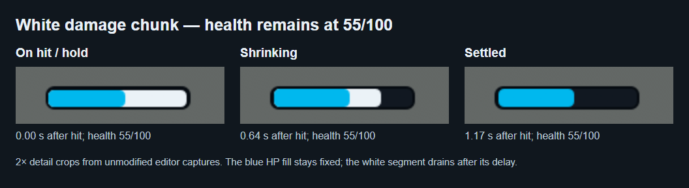

## Latest gameplay layout

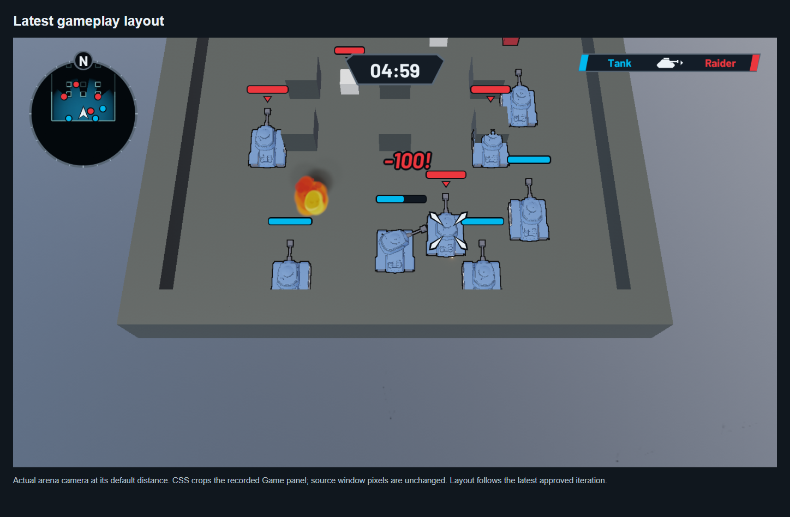

[Raw window capture](normal-play.png) | [Presentation HTML](comparison-normal-play.html) | [Capture metadata](normal-play.json)

## Compact upper-right kill feed and neutral hazard attribution

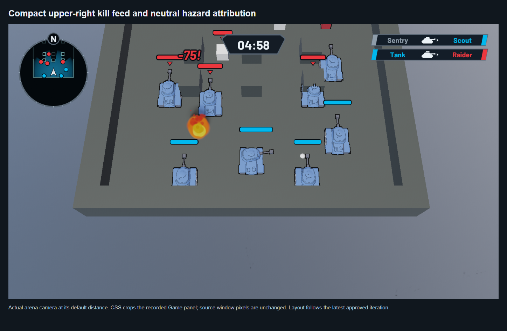

[Raw window capture](kill-feed.png) | [Presentation HTML](comparison-kill-feed.html) | [Capture metadata](kill-feed.json)

## Unchanged damage tiers, above projected HP

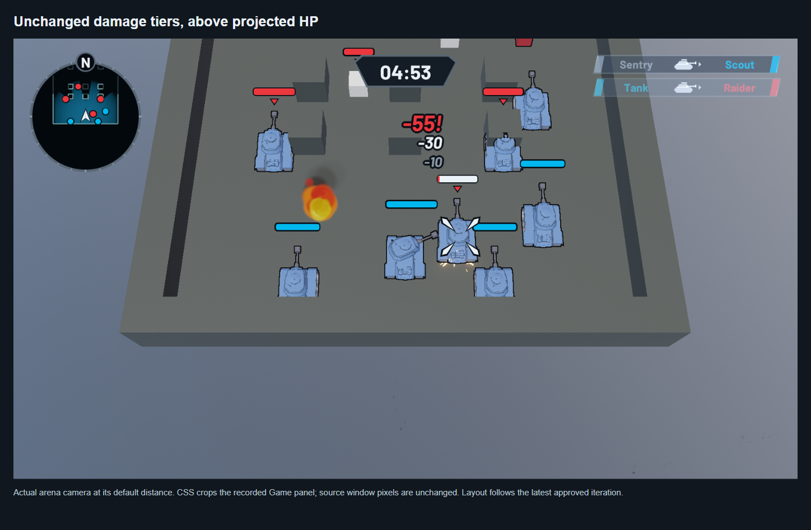

[Raw window capture](stacked-damage.png) | [Presentation HTML](comparison-stacked-damage.html) | [Capture metadata](stacked-damage.json)

## Playable contours and cover-clipped visibility

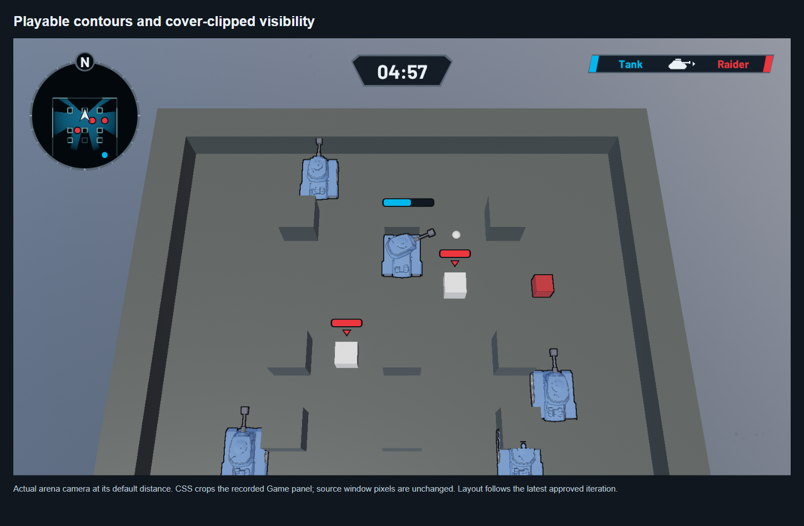

[Raw window capture](fog-contours.png) | [Presentation HTML](comparison-fog-contours.html) | [Capture metadata](fog-contours.json)

## Scoreboard with one clean edge

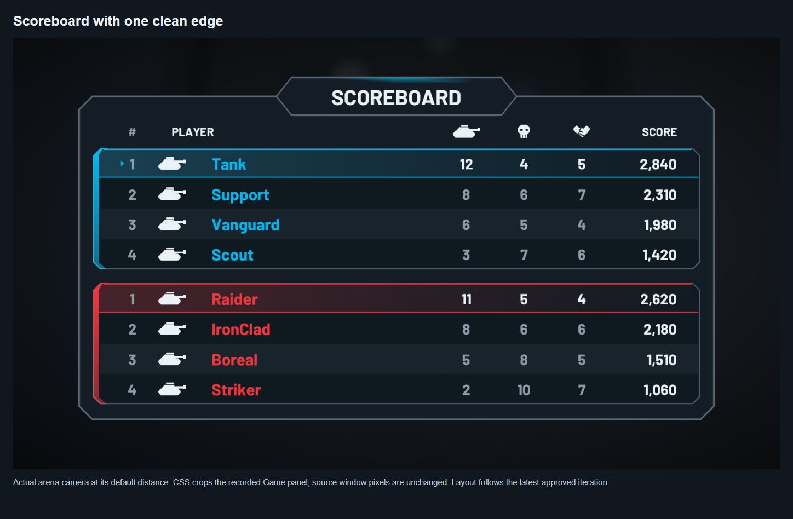

[Raw window capture](scoreboard-populated.png) | [Presentation HTML](comparison-scoreboard-populated.html) | [Capture metadata](scoreboard-populated.json)

## Incoming damage: white segment holds

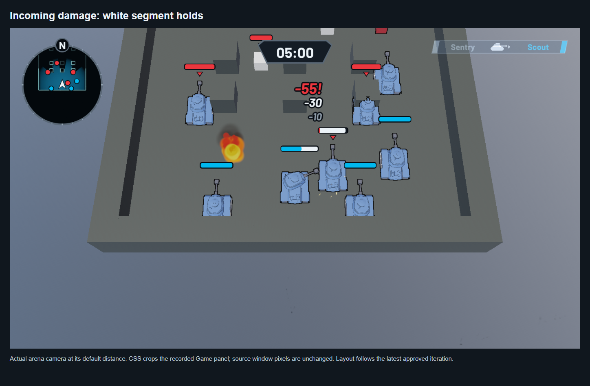

[Raw window capture](hp-hold.png) | [Presentation HTML](comparison-hp-hold.html) | [Capture metadata](hp-hold.json)

## Incoming damage: white segment drains

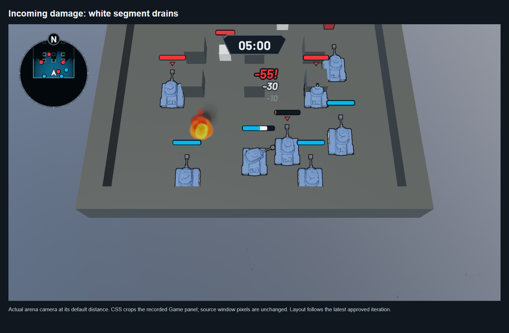

[Raw window capture](hp-mid-shrink.png) | [Presentation HTML](comparison-hp-mid-shrink.html) | [Capture metadata](hp-mid-shrink.json)

## Incoming damage: segment settles

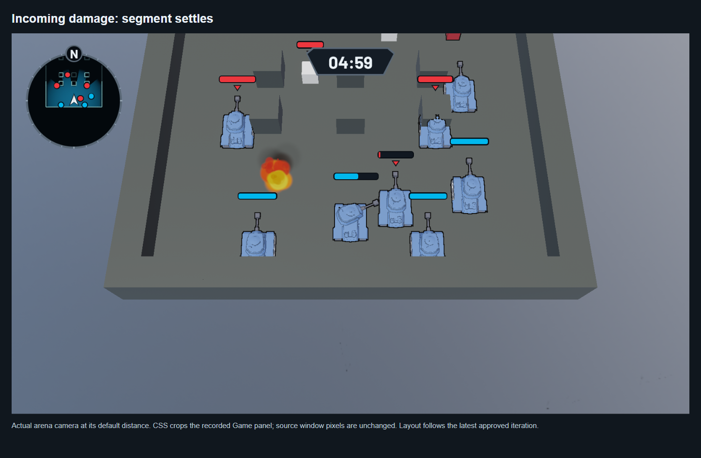

[Raw window capture](hp-settled.png) | [Presentation HTML](comparison-hp-settled.html) | [Capture metadata](hp-settled.json)

## 1800 x 1120 physical window: gameplay

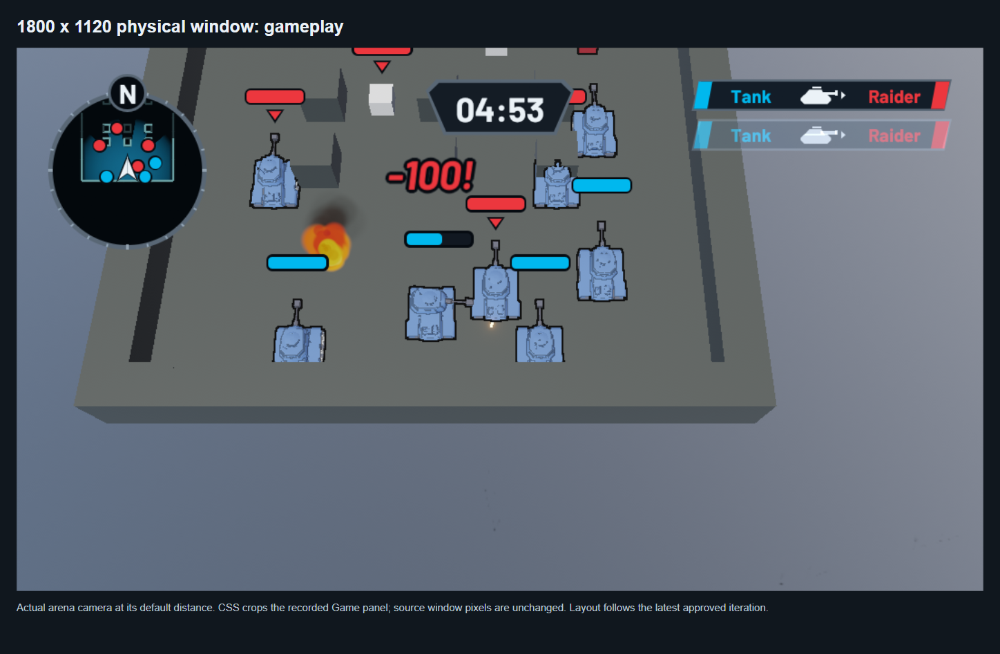

[Raw window capture](compact-gameplay.png) | [Presentation HTML](comparison-compact-gameplay.html) | [Capture metadata](compact-gameplay.json)

## 1800 x 1120 physical window: scoreboard

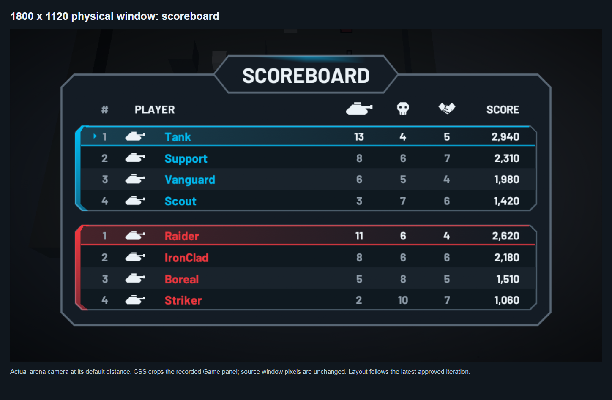

[Raw window capture](compact-scoreboard.png) | [Presentation HTML](comparison-compact-scoreboard.html) | [Capture metadata](compact-scoreboard.json)
