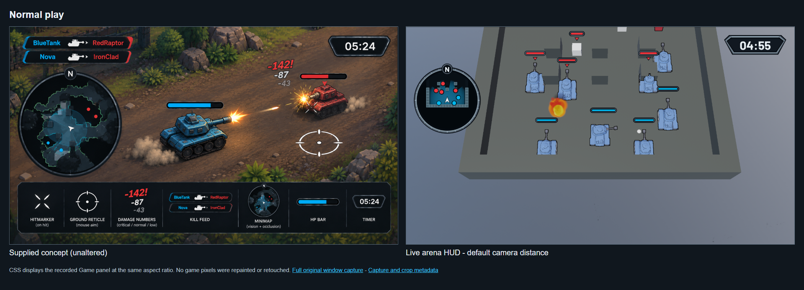
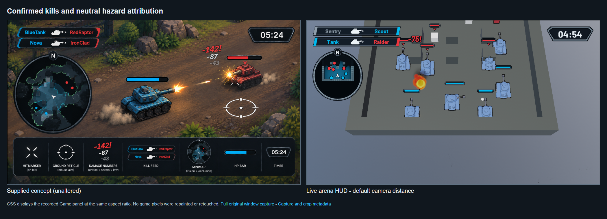
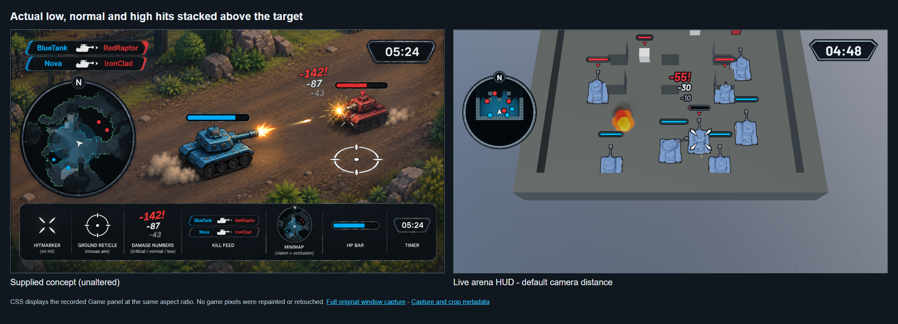
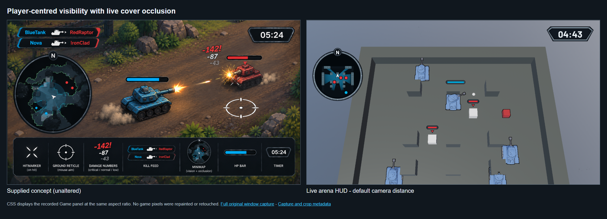
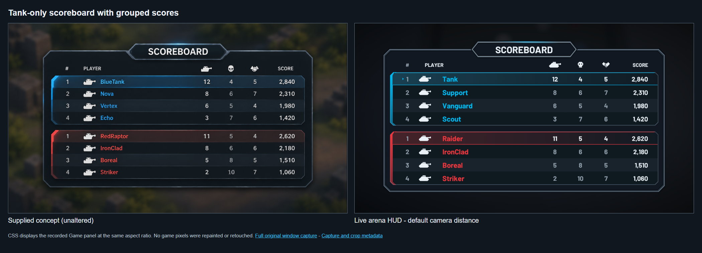
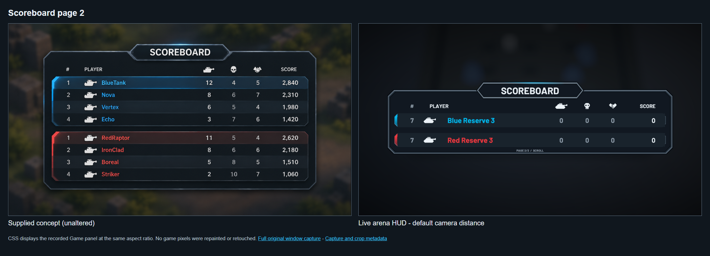
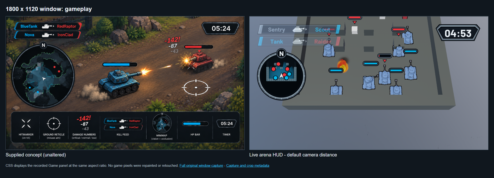
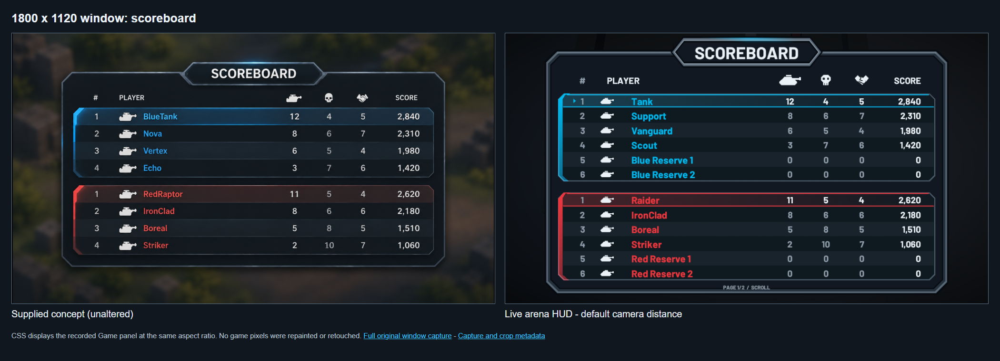

# HUD and scoreboard comparison evidence

Code snapshot: [3dbd5cd](https://github.com/cmilatinov/calyx-rust/commit/3dbd5cdabd446edc44978cb419c5b6be1b5282ad).

The left image in each comparison is the unchanged supplied concept. The right image is the Game panel from an unmodified `calyx_ctl` window capture, displayed at the same aspect ratio using the recorded panel rectangle. The paired PNG is a browser screenshot of the adjacent HTML; no gameplay pixels were repainted or retouched.

The arena camera retains its default height 34, back 13.7 and zoom 1. Runtime checks record unchanged camera zoom during scoreboard pagination, removal of the temporary blur volume on release, and the existing Crosshair object remaining visible.

The temporary play-copy fixture adds tank-controller participants with cloned tank mesh children. Normal combat captures use actual projectile damage: low/normal/high hits remove 10/30/55 HP. Combat attribution is recorded before synthetic score assignments in [combat-state.json](combat-state.json): a tank kill and assist award points, while Sentry kills add only the victim death and retain neutral kill-feed attribution.

The populated and paginated scoreboard captures use explicitly authored counters to exercise thousands separators and sorting, then seven tanks per team to exercise pagination. Those fixture counters are presentation evidence, not combat-attribution evidence. Sentry and Target A/B have no scoreboard row. The fog capture temporarily moves the player to [0, 0, 18] without changing camera distance. No fixture changes are saved into production assets.

See [runtime checks](runtime-checks.json) for camera, window sizing and fixture details. Each raw capture has its original capture and panel metadata alongside it.

## Normal play

[Raw window capture](normal-play.png) | [Comparison HTML](comparison-normal-play.html) | [Capture metadata](normal-play.json)

## Confirmed kills and neutral hazard attribution

[Raw window capture](kill-feed.png) | [Comparison HTML](comparison-kill-feed.html) | [Capture metadata](kill-feed.json)

## Actual low, normal and high hits stacked above the target

[Raw window capture](stacked-damage.png) | [Comparison HTML](comparison-stacked-damage.html) | [Capture metadata](stacked-damage.json)

## Player-centred visibility with live cover occlusion

[Raw window capture](fog-cover.png) | [Comparison HTML](comparison-fog-cover.html) | [Capture metadata](fog-cover.json)

## Tank-only scoreboard with grouped scores

[Raw window capture](scoreboard-populated.png) | [Comparison HTML](comparison-scoreboard-populated.html) | [Capture metadata](scoreboard-populated.json)

## Scoreboard page 2

[Raw window capture](scoreboard-second-page.png) | [Comparison HTML](comparison-scoreboard-second-page.html) | [Capture metadata](scoreboard-second-page.json)

## 1800 x 1120 window: gameplay

[Raw window capture](compact-gameplay.png) | [Comparison HTML](comparison-compact-gameplay.html) | [Capture metadata](compact-gameplay.json)

## 1800 x 1120 window: scoreboard

[Raw window capture](compact-scoreboard.png) | [Comparison HTML](comparison-compact-scoreboard.html) | [Capture metadata](compact-scoreboard.json)
