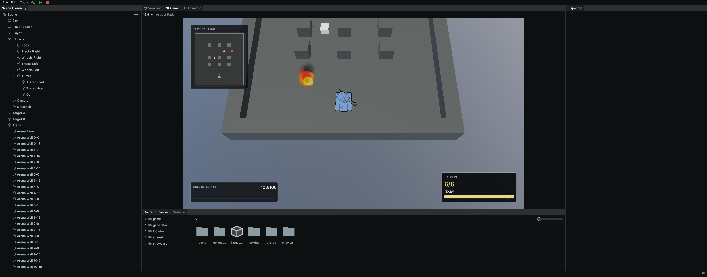
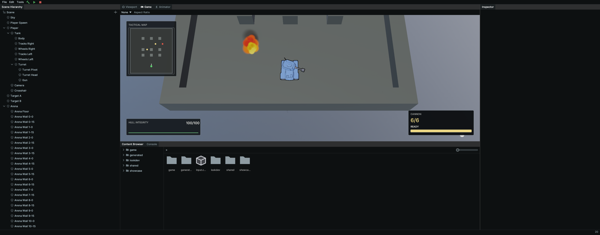

# Game tab rendering and input verification

Source revision: `8e50ac817cec9fae6c0de022000f5befa9d5ce6b`, PR #527, Engineering Task #515.

Unedited whole-window captures from `calyx_ctl screenshot --target window`, taken on Windows at 1.25 DPI scale in the arena scene. The captures show the final rebuilt source before its commit, with no intervening source edits. Both images are 3440 x 1351 pixels.

| Fixed 16:9 aspect | Free aspect after resizing, with corner aiming |
| --- | --- |
|  |  |

The fixed view has a 1658 x 933 game image, with the HUD inside the image and side letterbox bars outside it. The resized free view fills the available width with a 2062 x 726 image; the HUD remains anchored to its corners. The white ground aim marker is near the bottom right of the second image.

The corresponding hands-free check projected 27 injected cursor positions through fixed, free and resized layouts. The maximum alignment error was 0.0287 pixels. A separate logging-enabled smoke check confirmed assembly loading, play/pause/step/stop and nine repeated cursor positions, with zero ERROR entries. Startup 1x1 render-size warnings occur before panel sizing.

The known #514 debug startup stack issue was bypassed by changing only the built editor executable's stack reserve to 16 MiB. No tracked source or build settings were changed for that workaround. Exact command records and projection measurements are retained in the local verification archive.
