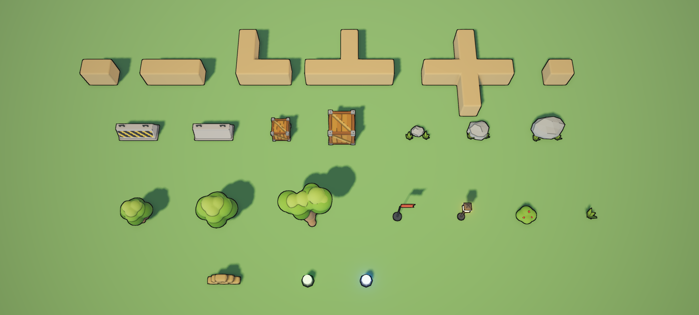
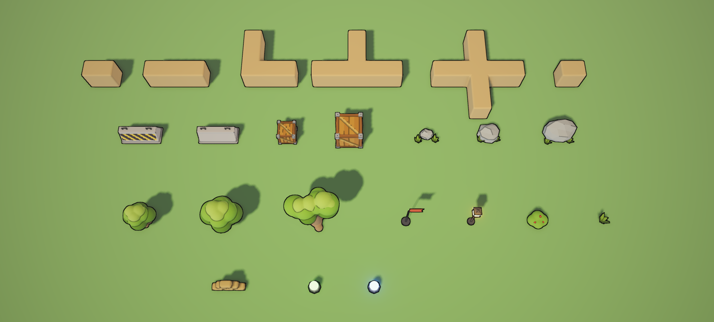

# Persistent post-processing verification

Source revision: `4215ed416f46a454b635c12db112b638df38a8ae`, Engineering Task #519.

Unedited 2062 x 932 game captures from `calyx_ctl`, using the repository-pinned Windows nightly and the task's own editor and sandbox build. The scene is `sandbox/assets/lookdev/tank_direction.cxscene` with temporary test volumes and a temporary profile; those verification assets were removed afterward. The original scene's SHA-256 remained unchanged.

| Profile resolution | Local component override |
| --- | --- |
|  |  |

`profile.png` follows conversion of eight global inline effects into a profile. Its pixels exactly match the inline capture. Changing outline styles through 1, 8, 2, 0, 8, 1 and restoring the original state also restores the exact image.

`local-fog.png` adds a radius-10000 local volume referencing that profile, with weight 0.5 and priority 10. Its component overrides fog with RGB 180/120/90, start 0, end 30 and opacity 0.8. The output changes; disabling the volume exactly restores `profile.png`.

The logging-enabled run recorded startup, assembly loading and scene/render activity, with zero ERROR entries. Startup 1x1 render-size warnings and missing outline-style diagnostics during the zero-style test were expected. The known #514 debug stack issue was bypassed by changing only the built editor executable's stack reserve to 16 MiB. No tracked source or build settings were changed for that workaround.

SHA-256:

- `profile.png`: `6BEA18265693477057BDCBFA06501D8E83D9CC04FF1982FCB012232C4262F415`
- `local-fog.png`: `F3BB9E8046ECF09D1071D15BEB62ADCACA153A6AC845ED4F4FEAFC3DA3951AFD`
